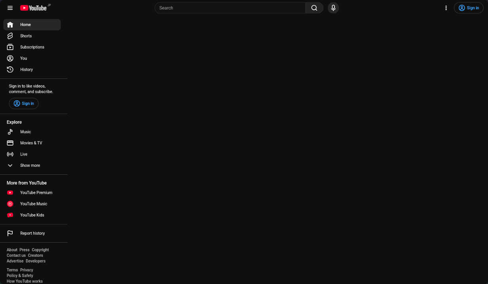
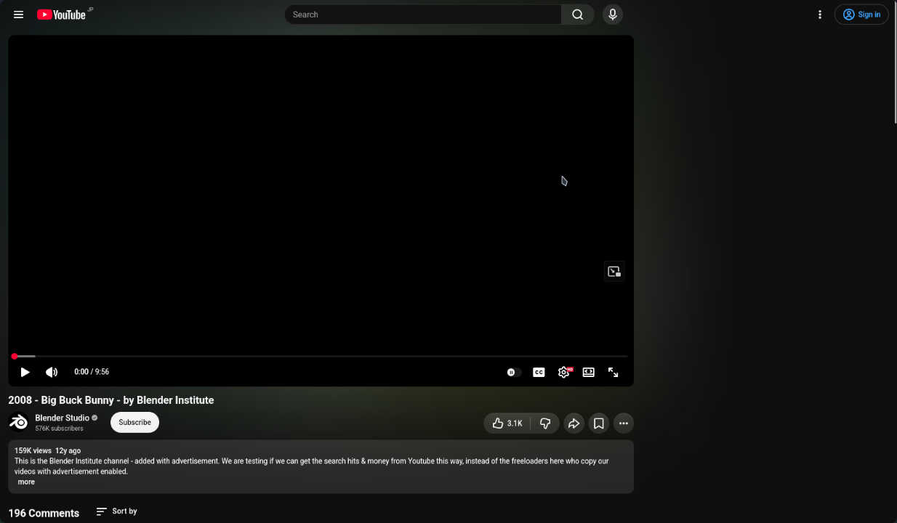

# UserCSS for YouTube

> [!TIP]
> このUserCSSは通常の人にはオススメできません。

## resize-youtube-grid.user.css

このUserCSSはYouTubeのホームでグリッドサイズを任意のものに変更できます。過去のYouTubeでは、PCでホームフィードにアクセスすると横に6つの動画が並んでいましたが、ある時から5つになってしまったことをきっかけに作成しました。このスタイルはグリッドサイズ以外にも見た目の変更を伴うため、必要なければオプションでオフにしてください。

現在は使用していないため、やがて動作しなくなると思います。

## youtube-mental-style.user.css

このスタイルは極端なものであり、ホームの動画の非表示と関連動画の非表示をします。また、推奨動画のサムネイルをグレースケールで表示します。

これは管理の手間を省くためにどんどん単純化させています。

### スクリーンショット

ホームグリッドの非表示

関連動画の非表示

## インストール Installation

[Stylus 拡張機能](https://github.com/openstyles/stylus?tab=readme-ov-file#releases)の使用を想定しています。Stylus拡張機能がインストールされている環境では、ファイルを開くことでインストール画面になると思います。

- [youtube-mental-style.user.css](https://git.sumiinix.moe/Sumiinix/usercss-youtube/raw/branch/main/youtube-mental-style.user.css)
- [resize-youtube-grid.user.css](https://git.sumiinix.moe/Sumiinix/usercss-youtube/raw/branch/main/resize-youtube-grid.user.css)
