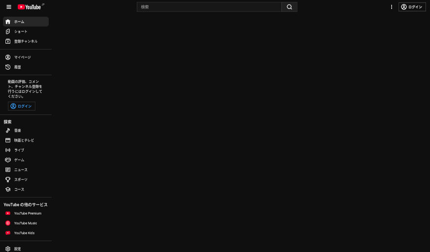
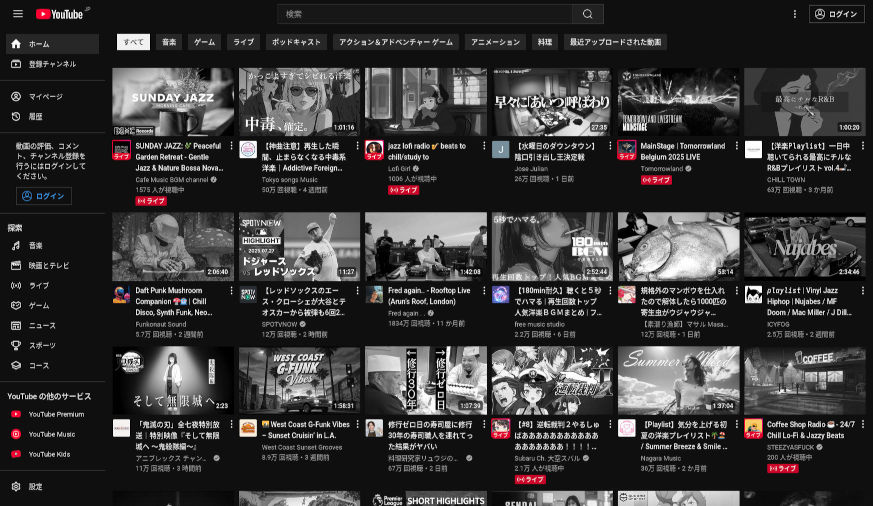
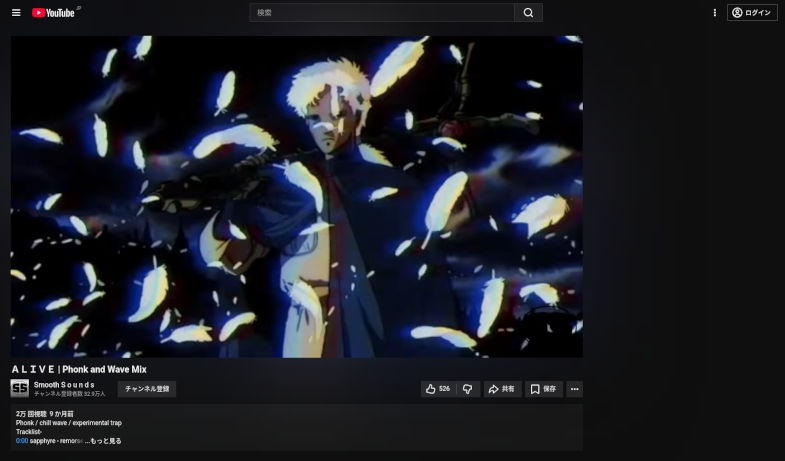

# UserCSS

## YouTube mental style (youtube-mental-style.user.css)

私は、YouTubeに他のフロントエンドを使ってアクセスしています。しかし、フロントエンドが動作しなくなった場合は、YouTubeに直接アクセスする必要があるでしょう。\
I access YouTube using another frontend. However, if the frontend stops working, I will need to access YouTube directly.

しかし、YouTubeの見た目は最悪です。これらをある程度パーソナライズするには、アカウントが必要になります。一方で、過去の時点でパーソナライズされたYouTubeのおすすめがひどいと気づいています。パーソナライズされたYouTubeのおすすめは下水道ですが、パーソナライズされていないYouTubeは最悪の地獄です。\
However, the appearance of YouTube is terrible. To personalize it to some extent, an account is required. On the other hand, I have realized that the personalized recommendations on YouTube were terrible at some point in the past. Personalized YouTube recommendations are like a sewer, but non-personalized YouTube is the worst hell.

[ex444.jpg](screenshots/ex444.jpg)と[ex444-2.jpg](screenshots/ex444-2.jpg)に、今のホームの見た目を示します（⚠️自己責任で見てください）。最初は動画がおすすめされないので、これらの画像は音楽を1曲聞いたり、実況動画を1つ見た後の様子になります。\
The images [ex444.jpg](screenshots/ex444.jpg) and [ex444-2.jpg](screenshots/ex444-2.jpg) show what my current home screen looks like (⚠️ view at your own risk). At first, no videos are recommended, so these images are from after listening to one song or watching one gameplay video.

ホーム画面を見ると気が狂いそうになりました。なるべく精神の状態を正気に保つ必要がありました。だから、スタイルを作りました。今まで作ってきたスタイルと目的が少し異なる気がしたので、`resize-youtube-grid.user.css`から新しく`youtube-mental-style.user.css`を作成しました。\
Looking at the home screen made me feel like I was going crazy. I had to keep my mental state as sane as possible. So, I created a style. I felt that the style I had been creating was slightly different from my purpose, so I made a new `youtube-mental-style.user.css` from the original `resize-youtube-grid.user.css`.

このユーザスタイルは通常のユーザには向いていません。普段YouTubeを直接使わない人が、YouTubeを使わざるを得なくなった時に、精神を正常に保つためのものです。\
This user style is not intended for regular users. It is meant for those who usually do not use YouTube directly but find themselves having to use it, in order to keep their mental state normal.

### インストール Installation

[Stylus 拡張機能](https://github.com/openstyles/stylus?tab=readme-ov-file#releases)の使用を想定しています。\
It is assumed that you will be using the [Stylus extension](https://github.com/openstyles/stylus?tab=readme-ov-file#releases).

Stylus拡張機能にuser.cssを適用してもらいます。下記のリンクにアクセスすると、インストールできることを願っております。\
Please apply the user.css to the Stylus extension. I hope you can install it by accessing the link below.

[Install resize-youtube-grid.user.css](https://codeberg.org/Sumiinix/style-youtube-grid/raw/branch/main/youtube-mental-style.user.css)

### スクリーンショット

ホームグリッドの非表示を無効にする場合 :

プレイヤーページ :

---

## old (resize-youtube-grid.user.css)

I created this [UserCSS](https://github.com/openstyles/stylus/wiki/Usercss) to adjust the number of videos displayed in YouTube's grid layout.  
 Instead of specifying the number of videos per row, this style adjusts the width of the thumbnails.  
 Since the number of videos per row is not fixed, thumbnails will not become squished even if you reduce the browser window's width.

After initially creating this, I found myself wanting to modify other visual aspects as well, so I added a few more tweaks.  
 If you don't need some of the additional features, please feel free to disable them in the style settings.

### Limitations

YouTube frequently conducts [A/B testing](https://en.wikipedia.org/wiki/A/B_testing), which may cause this style to stop working.  
I have personally encountered cases where the style worked on one account but not on another.

Additionally, since YouTube's layout changes often, some settings might already be outdated.  
Recently, I started using [alternative frontends](https://github.com/mendel5/alternative-front-ends?tab=readme-ov-file#youtube) to avoid YouTube's excessive algorithm influence, so I use the official YouTube site less frequently now.  
As a result, it has become difficult for me to maintain this style.  
Feel free to copy, modify, and share this style with anyone who might find it helpful.

### Known Issues

When adjusting thumbnail width, ghost cards (placeholders) that appear during grid loading are hidden.  
This is because I couldn't make the ghost cards display properly under the modified layout.

The thumbnail width dynamically changes depending on your browser window size, ranging between the values set in "Content Size (px) → Width" and "Content Size (px) → Max Width" in the style settings.  
Due to variations in the number of videos per row (e.g., fewer videos because of ad blockers), the last row might have fewer thumbnails than others. In such cases, thumbnails on the last row can appear larger — up to the "Max Width" you set.

If you don't fully understand this behavior, try scrolling to the bottom of your [YouTube homepage](https://www.youtube.com/) and observe the thumbnail sizes before new videos load.

If you prefer a consistent thumbnail size regardless of browser width, set the same value for both "Width" and "Max Width" in the style settings.

### Recommendations

I recommend using an ad blocker such as the [uBlock Origin](https://ublockorigin.com/) extension.

The [Improve YouTube](https://github.com/code-charity/youtube) extension can further enhance your YouTube experience.

You can achieve features that UserCSS alone cannot provide by using [UserScripts](https://en.wikipedia.org/wiki/Userscript).  
There are extensions such as [Violentmonkey](https://violentmonkey.github.io/), [Greasemonkey](https://www.greasespot.net/), and [Tampermonkey](https://www.tampermonkey.net/).
You can find many user-created scripts on [greasyfork.org](https://greasyfork.org/).

You can also find other UserCSS styles by searching on [userstyles.world](https://userstyles.world/).

---

I came up with all the content for user.css myself.

This repository uses machine translation (Google Translate). Also LLM is used for translation (ChatGPT or LocalLLM).
