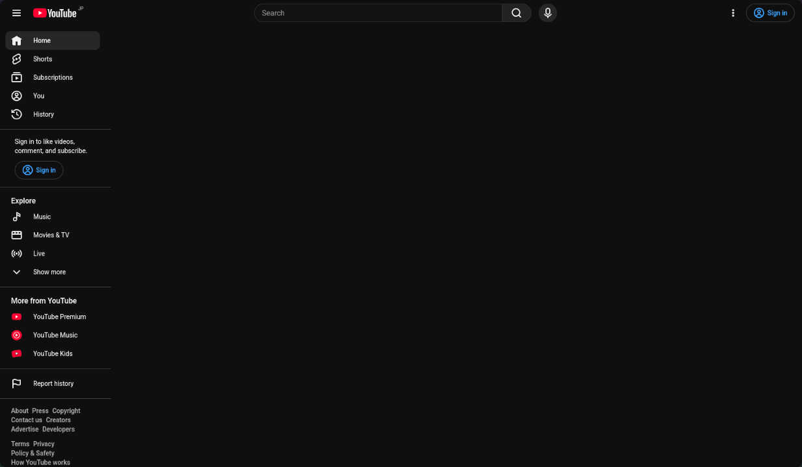
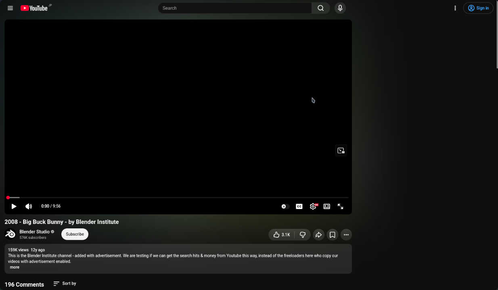

# UserCSS for YouTube

> [!TIP]
> This UserCSS is not recommended for most people.

## resize-youtube-grid.user.css

This UserCSS allows you to adjust the grid size on the YouTube homepage. I created this because, previously, YouTube displayed six videos horizontally when accessing the home feed on a PC, but at some point, it changed to five. This style also changes the appearance in addition to the grid size, so please turn it off in the options if you don't need it.

I haven't used it recently, so I think it will eventually stop working.

## youtube-mental-style.user.css

This style is extreme, hiding both the home video and related videos. It also displays recommended video thumbnails in grayscale.

This is being simplified more and more to reduce the effort required for management.

### Screenshot

Hide home grid:

Hide related videos:

## Installation

[Stylus Extension](<https://github.com/openstyles/stylus?tab=readme-ov-file#releases>) is intended for use. If you have the Stylus extension installed, opening the file should take you to the installation screen.

- [youtube-mental-style.user.css](https://git.sumiinix.moe/Sumiinix/usercss-youtube/raw/branch/main/youtube-mental-style.user.css)
- [resize-youtube-grid.user.css](https://git.sumiinix.moe/Sumiinix/usercss-youtube/raw/branch/main/resize-youtube-grid.user.css)
